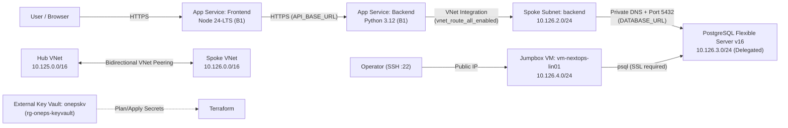

# NextOps Azure PaaS Landing Zone (`infra-nextops`)

Terraform Infrastructure-as-Code (IaC) and operational deployment scripts for the **NextOps Industrial** telemetry and digital-twin platform on Microsoft Azure.

This repository provisions a hub-and-spoke Azure landing zone hosting a Node.js/React SPA dashboard (`nextops-dashboard`), a VNet-integrated Python FastAPI backend (`nextops-be`), a private Azure Database for PostgreSQL Flexible Server (`nextops-dev-psql-db` / `nextops-prod-psql-db`), Private DNS integration, and an Ubuntu Linux jumpbox VM.

---

## Architecture Overview


### Network & Traffic Flow



---

## Repository Structure

```text
infra-nextops/
├── .gitignore                          # Ignores *.tfstate, .terraform/, crash logs, OS files
├── docs/
│   └── nextops-landing-zone-paas.png   # Reference PaaS landing zone architecture diagram
├── environments/
│   ├── dev/                            # Active dev environment (centralindia, rg-nextops-dev-01)
│   │   ├── README.md
│   │   ├── backend.tf                  # Remote azurerm backend intentionally commented out (local state)
│   │   ├── data.tf                     # External Key Vault secret lookups & caller IP lookup
│   │   ├── local.tf                    # Naming, CIDR calculation, Web App app_settings assembly
│   │   ├── main.tf                     # Root module orchestration
│   │   ├── outputs.tf                  # DB FQDN, jumpbox IP, Web App URLs, RG names
│   │   ├── provider.tf                 # hashicorp/azurerm ~> 5.0 & hashicorp/http
│   │   ├── terraform.tfvars            # Dev environment configuration
│   │   └── variables.tf
│   └── prod/                           # Production environment (parity with dev PaaS topology)
│       ├── README.md
│       └── ...
├── modules/
│   ├── resource group/                 # Azure Resource Group provisioning
│   ├── hub and spoke network/          # VNets, CIDR-derived subnets, delegations, bidirectional peering
│   ├── virtual machine/                # Multi-OS VM (Ubuntu/Windows), NIC, NSG, optional Public IP
│   ├── private dns zone /              # Private DNS zone + VNet link for PostgreSQL
│   ├── database for postgreSQL /       # Private PostgreSQL Flexible Server v16 + conditional firewall rules
│   └── webapp/                         # Linux App Service Plan + Linux Web App (Node / Python)
├── nextops-db-init.sh                  # Creates DB & seeds public.telemetry (run from inside VNet)
├── nextops-deploy-backend.sh           # Deploys nextops-backend.zip to App Service (nextops-be)
├── nextops-deploy-frontend.sh          # Deploys nextops-dashboard-build.zip to App Service (nextops-dashboard)
├── nextops-backend.zip                 # Prebuilt FastAPI backend package
└── nextops-dashboard-build.zip         # Prebuilt React/Vite SPA dist package
```

---

## Web App (App Service) Configuration

Both frontend and backend run on **Azure App Service for Linux** via [`modules/webapp`](./modules/webapp/README.md). Every Web App enforces `https_only = true` and `always_on = true`.

### Configured Workloads (`dev` & `prod`)

| Property | Frontend (`frontend-webapp`) | Backend (`backend_webapp`) |
| :--- | :--- | :--- |
| **App Service Name (`dev` / `prod`)** | `nextops-dashboard` / `nextops-dashboard-prod` | `nextops-be` / `nextops-be-prod` |
| **App Service Plan (`dev` / `prod`)** | `asp-linux-webapp-frontend` / `...-prod` | `asp-linux-webapp-backend` / `...-prod` |
| **OS / SKU** | `Linux` / `B1` | `Linux` / `B1` |
| **App Type & Runtime** | `node` (`24-lts`) | `python` (`3.12`) |
| **Public Network Access** | `true` | `true` |
| **VNet Integration (`delegated_subnet_key`)** | `null` (not VNet-integrated) | `backend-subnet` (`subnet-nextops-<env>-be01`, `vnet_route_all_enabled = true`) |
| **Startup Command (`app_command_line`)** | `pm2 serve /home/site/wwwroot --no-daemon --spa` | `python -m uvicorn main:app --host 0.0.0.0 --port 8000` |

### Environment Variables (`app_settings`)

[`modules/webapp/local.tf`](./modules/webapp/local.tf) merges **stack defaults** with **environment-specific overrides** from `environments/<env>/local.tf`:

| Stack / Tier | Variable | Value / Source | Purpose |
| :--- | :--- | :--- | :--- |
| **Node (default)** | `SCM_DO_BUILD_DURING_DEPLOYMENT` | `"false"` | Serves prebuilt SPA bundle (`nextops-dashboard-build.zip`) without running Oryx build on deploy |
| **Node (env)** | `API_BASE_URL` | `https://<backend-webapp>.azurewebsites.net` | Target backend API base URL for the dashboard |
| **Node (env)** | `ENVIRONMENT` | `var.environment` (`dev` / `prod`) | Runtime environment identifier |
| **Python (default)** | `SCM_DO_BUILD_DURING_DEPLOYMENT` | `"true"` | Triggers Oryx `pip install` on zip deployment for `nextops-backend.zip` |
| **Python (default)** | `PORT` | `"8000"` | Aligns App Service container port with Uvicorn `--port 8000` |
| **Python (env)** | `ENVIRONMENT` | `var.environment` (`dev` / `prod`) | Overrides default `"development"` with active environment |
| **Python (env)** | `DATABASE_URL` | `postgresql://<db_user>:<urlencoded_db_password>@<psql_fqdn>:5432/<database_name>` | Connection string resolved via Private DNS over VNet integration |

> **Note:** `DATABASE_URL` URL-encodes the database password (`urlencode(...)`) in `local.tf` so special characters in Key Vault secrets do not break PostgreSQL URI parsing.

---

## Prerequisites & External Dependencies

1. **CLI Tools**:
   - Terraform (`>= 1.5`, provider `hashicorp/azurerm ~> 5.0`)
   - Azure CLI (`az`), authenticated via `az login` with access to target subscription
   - `psql` (`libpq`) on the jumpbox VM for database initialization
2. **Pre-Existing Azure Key Vault**:
   Terraform reads secrets at plan/apply time from an external Key Vault configured in `key_vault_details`:
   - **Key Vault**: `onepskv` in resource group `rg-oneps-keyvault`
   - **Required Secrets**:
     - `vm-username` — Jumpbox Linux VM admin username
     - `vm-password` — Jumpbox Linux VM admin password (used when `authentication_method = "password"`)
     - `linux-vm-ssh-public-key` — Jumpbox SSH public key (used when `authentication_method = "ssh_key"`)
     - `db-username` — PostgreSQL Flexible Server administrator username
     - `db-password` — PostgreSQL Flexible Server administrator password

---

## Provisioning & Deployment Runbook

### 1. Provision Infrastructure

```bash
cd environments/dev   # or environments/prod
terraform init
terraform plan
terraform apply
```

Capture the outputs (`postgreSQL_fqdn`, `vm_public_ip`, `webapp`, `resource_group_output`).

### 2. Initialize PostgreSQL Schema & Seed Data

Because `public_network_access_enabled = false` on the PostgreSQL Flexible Server, run `nextops-db-init.sh` **from inside the VNet** (e.g., on `vm-nextops-lin01`):

```bash
# Copy script to jumpbox
scp nextops-db-init.sh <vm_username>@<vm_public_ip>:~

# SSH into jumpbox and execute
ssh <vm_username>@<vm_public_ip>
chmod +x nextops-db-init.sh
./nextops-db-init.sh
```

The script prompts for the PostgreSQL admin credentials and database name (default: `nextops`), creates the database if missing, creates `public.telemetry` with index `idx_telemetry_device_timestamp`, and seeds 144 sample telemetry rows (12 devices × 12 hours).

### 3. Deploy Application Packages

From the `infra-nextops/` root directory (authenticated with `az login`):

```bash
# Deploy Python FastAPI backend to nextops-be
./nextops-deploy-backend.sh

# Deploy prebuilt React SPA frontend to nextops-dashboard
./nextops-deploy-frontend.sh
```

> Both scripts use `az webapp deploy --type zip` against the production slot while leaving Terraform-managed `app_settings`, runtime versions, and startup commands intact.

---

## Operational Notes & Known Gotchas

- **Local State by Design**: `environments/dev/backend.tf` and `environments/prod/backend.tf` intentionally leave the `azurerm` remote backend commented out. `.gitignore` excludes `*.tfstate` and `*.tfstate.*` so local state files are never committed to Git. Enable the `azurerm` backend block before team/CI-CD usage.
- **Private Database Access**: `nextops-dev-psql-db` has public network access disabled (`public_network_access_enabled = false`). Direct `psql` connections from a developer laptop will fail unless connected through the spoke VNet (e.g., via `vm-nextops-lin01`) where `nextops-psqlflexibleserver.postgres.database.azure.com` resolves via Private DNS.
- **VNet Integration & DNS**: Only `backend_webapp` (`nextops-be`) is VNet-integrated (`delegated_subnet_key = "backend-subnet"`, `vnet_route_all_enabled = true`). This ensures outbound DB traffic routes through the spoke VNet and resolves the Private DNS zone.
- **Module Folder Names**: Two legacy module directories (`modules/database for postgreSQL ` and `modules/private dns zone `) contain a trailing space in their directory names. Keep the exact `source` paths in `main.tf` unless renaming them across all environments.
- **Key Vault & Data Sources**: `data.http.my_ip` calls `https://api.ipify.org` during `terraform plan/apply`. Outbound internet access from the machine running Terraform is required even when `login_thru_this_pc = "no"`.
