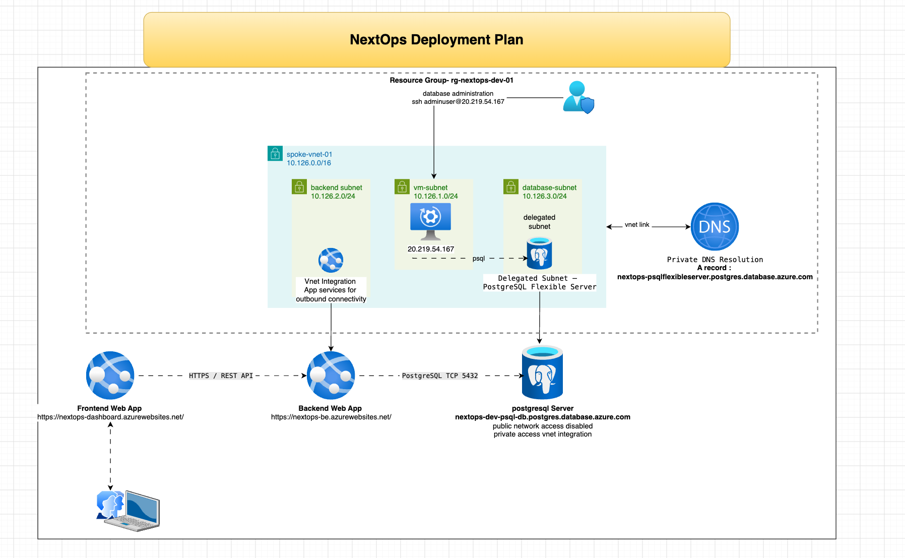
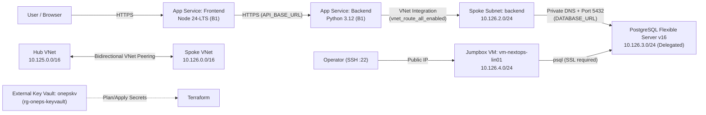

<div align="center">

# NextOps Azure PaaS Landing Zone

**Production-ready Terraform Infrastructure-as-Code & Deployment Automation for the NextOps Industrial Digital Twin Platform**

[](https://www.terraform.io/)
[](https://azure.microsoft.com/)
[](https://registry.terraform.io/providers/hashicorp/azurerm/latest)
[](https://azure.microsoft.com/en-us/products/postgresql)
[](./LICENSE)

</div>

---

## Table of Contents

- [Architecture Overview](#architecture-overview)
- [Architectural Pillars & Security Controls](#architectural-pillars--security-controls)
- [Network & Subnet Allocation](#network--subnet-allocation)
- [Web App (App Service) Configuration](#web-app-app-service-configuration)
- [Modular Repository Structure](#modular-repository-structure)
- [Prerequisites & Key Vault Contract](#prerequisites--key-vault-contract)
- [Provisioning & Deployment Runbook](#provisioning--deployment-runbook)
- [License](#license)
- [Author & Architecture Credit](#author--architecture-credit)

---

## Architecture Overview

This repository provisions a modular, security-hardened **hub-and-spoke Azure PaaS landing zone** in **Central India** for the **NextOps Industrial** telemetry and digital-twin platform:

- **Frontend Tier**: Linux App Service (`Node 24-LTS`) serving the React/Vite SPA dashboard via `pm2`.
- **API Tier**: VNet-integrated Linux App Service (`Python 3.12`) running FastAPI (`uvicorn`) with private outbound routing.
- **Data Tier**: Private Azure Database for PostgreSQL Flexible Server (`v16`) with zero public internet exposure and Azure Private DNS resolution.
- **Management Tier**: Dedicated Ubuntu jumpbox VM (`Standard_D2s_v5`) for secure VNet-internal database administration.



### Traffic & Control Flow



---

## Architectural Pillars & Security Controls

| Pillar | Implementation |
| :--- | :--- |
| **Hub-and-Spoke Segmentation** | Separates shared connectivity (`vnet-nextops-<env>-hub01`) from workload tiers (`vnet-nextops-<env>-spk01`) using bidirectional VNet peering with `allow_forwarded_traffic = true`. |
| **Zero Public Exposure on Data Tier** | PostgreSQL Flexible Server runs with `public_network_access_enabled = false`, delegated to `subnet-nextops-<env>-pg01`, and resolved internally via `nextops-psqlflexibleserver.postgres.database.azure.com`. |
| **VNet-Integrated Compute** | The FastAPI backend App Service integrates with `subnet-nextops-<env>-be01` (`Microsoft.Web/serverFarms` delegation) and enforces `vnet_route_all_enabled = true` so all DB traffic stays on private IP space. |
| **Zero-Secret Repository** | All VM and database credentials are retrieved dynamically at plan/apply time from Azure Key Vault (`onepskv`), while `.gitignore` excludes all `*.tfstate` and `.terraform/` artifacts. |
| **Environment Parity (`dev` & `prod`)** | Both environments share identical module orchestration, CIDR math, and PaaS topology, with `prod` dynamically deriving `API_BASE_URL` from its backend App Service name. |

---

## Network & Subnet Allocation

| VNet / Subnet | Naming (`<env>` = `dev` \| `prod`) | CIDR | Delegation / Role |
| :--- | :--- | :--- | :--- |
| **Hub VNet** | `vnet-nextops-<env>-hub01` | `10.125.0.0/16` | Connectivity hub, peered with spoke |
| **Spoke VNet** | `vnet-nextops-<env>-spk01` | `10.126.0.0/16` | Workload spoke, linked to Private DNS Zone |
| **Frontend Subnet** | `subnet-nextops-<env>-fe01` | `10.126.1.0/24` | Frontend tier reservation |
| **Backend Subnet** | `subnet-nextops-<env>-be01` | `10.126.2.0/24` | Delegated: `Microsoft.Web/serverFarms` (App Service VNet integration) |
| **Database Subnet** | `subnet-nextops-<env>-pg01` | `10.126.3.0/24` | Delegated: `Microsoft.DBforPostgreSQL/flexibleServers` |
| **Jumpbox Subnet** | `subnet-nextops-<env>-vm01` | `10.126.4.0/24` | Management VM (`vm-nextops-lin01`) + NSG (SSH `:22`) |

---

## Web App (App Service) Configuration

Both tiers are provisioned on **Azure App Service for Linux** via [`modules/webapp`](./modules/webapp/README.md) with `https_only = true` and `always_on = true`.

### Runtime & Startup Commands

| Property | Frontend (`frontend-webapp`) | Backend (`backend_webapp`) |
| :--- | :--- | :--- |
| **App Service Name (`dev` / `prod`)** | `nextops-dashboard` / `nextops-dashboard-prod` | `nextops-be` / `nextops-be-prod` |
| **App Service Plan (`dev` / `prod`)** | `asp-linux-webapp-frontend` / `...-prod` | `asp-linux-webapp-backend` / `...-prod` |
| **OS / SKU** | `Linux` / `B1` | `Linux` / `B1` |
| **App Type & Runtime** | `node` (`24-lts`) | `python` (`3.12`) |
| **Public Network Access** | `true` | `true` |
| **VNet Integration** | `null` (public ingress) | `backend-subnet` (`vnet_route_all_enabled = true`) |
| **Startup Command (`app_command_line`)** | `pm2 serve /home/site/wwwroot --no-daemon --spa` | `python -m uvicorn main:app --host 0.0.0.0 --port 8000` |

### Environment Variables (`app_settings`)

[`modules/webapp/local.tf`](./modules/webapp/local.tf) merges **stack defaults** with **environment-specific overrides** from `environments/<env>/local.tf`:

| Stack / Tier | Variable | Value / Source | Purpose |
| :--- | :--- | :--- | :--- |
| **Node (default)** | `SCM_DO_BUILD_DURING_DEPLOYMENT` | `"false"` | Serves prebuilt SPA bundle (`nextops-dashboard-build.zip`) without Oryx rebuild |
| **Node (env)** | `API_BASE_URL` | `https://<backend-webapp>.azurewebsites.net` | Target backend API base URL for the dashboard |
| **Node (env)** | `ENVIRONMENT` | `var.environment` (`dev` / `prod`) | Runtime environment identifier |
| **Python (default)** | `SCM_DO_BUILD_DURING_DEPLOYMENT` | `"true"` | Triggers Oryx `pip install` on zip deployment for `nextops-backend.zip` |
| **Python (default)** | `PORT` | `"8000"` | Aligns App Service container port with Uvicorn `--port 8000` |
| **Python (env)** | `ENVIRONMENT` | `var.environment` (`dev` / `prod`) | Overrides default `"development"` with active environment |
| **Python (env)** | `DATABASE_URL` | `postgresql://<db_user>:<urlencoded_db_password>@<psql_fqdn>:5432/<database_name>` | Private PostgreSQL connection string resolved via Private DNS over VNet integration |

> `DATABASE_URL` automatically URL-encodes the database password (`urlencode(...)`) in `local.tf` so special characters in Key Vault secrets do not break PostgreSQL URI parsing.

---

## Modular Repository Structure

| Component | Path | Documentation |
| :--- | :--- | :--- |
| **Dev Environment** | `environments/dev/` | [environments/dev/README.md](./environments/dev/README.md) |
| **Prod Environment** | `environments/prod/` | [environments/prod/README.md](./environments/prod/README.md) |
| **Resource Group Module** | `modules/resource group/` | [modules/resource group/README.md](./modules/resource%20group/README.md) |
| **Hub & Spoke Network Module** | `modules/hub and spoke network/` | [modules/hub and spoke network/README.md](./modules/hub%20and%20spoke%20network/README.md) |
| **Virtual Machine Module** | `modules/virtual machine/` | [modules/virtual machine/README.md](./modules/virtual%20machine/README.md) |
| **Private DNS Zone Module** | `modules/private dns zone /` | [modules/private dns zone /README.md](./modules/private%20dns%20zone%20/README.md) |
| **PostgreSQL Flexible Server Module** | `modules/database for postgreSQL /` | [modules/database for postgreSQL /README.md](./modules/database%20for%20postgreSQL%20/README.md) |
| **Web App Module** | `modules/webapp/` | [modules/webapp/README.md](./modules/webapp/README.md) |

---

## Prerequisites & Key Vault Contract

1. **CLI Tools**: Terraform (`>= 1.5`), Azure CLI (`az`, authenticated via `az login`), and `psql` (`libpq`) on the jumpbox VM.
2. **External Azure Key Vault**: `onepskv` in resource group `rg-oneps-keyvault`, containing:
   - `vm-username` & `vm-password` (or `linux-vm-ssh-public-key` for SSH auth)
   - `db-username` & `db-password`

---

## Provisioning & Deployment Runbook

### 1. Provision Azure Infrastructure

```bash
cd environments/dev   # or environments/prod
terraform init
terraform plan
terraform apply
```

### 2. Initialize Private PostgreSQL Schema & Seed Data

Run `nextops-db-init.sh` from inside the spoke VNet via the jumpbox VM (`vm-nextops-lin01`):

```bash
scp nextops-db-init.sh <vm_username>@<vm_public_ip>:~
ssh <vm_username>@<vm_public_ip>
chmod +x nextops-db-init.sh
./nextops-db-init.sh
```

Creates the `nextops` database, `public.telemetry` table, index `idx_telemetry_device_timestamp`, and seeds 144 sample telemetry rows (12 devices × 12 hours).

### 3. Deploy Application Packages

From the `infra-nextops/` root directory (authenticated with `az login`):

```bash
./nextops-deploy-backend.sh    # Deploys nextops-backend.zip -> nextops-be
./nextops-deploy-frontend.sh   # Deploys nextops-dashboard-build.zip -> nextops-dashboard
```

---

## License

This project is licensed under the **MIT License** — see the [LICENSE](./LICENSE) file for details.

---

## Author & Architecture Credit

- **Infrastructure Design & Landing Zone Architecture**: **Sanjeev Singh** ([GitHub](https://github.com/sanjiivsingh))
- **Scope**: End-to-end Azure PaaS landing zone architecture, hub-and-spoke network topology, reusable Terraform child modules, private PostgreSQL + Private DNS integration, App Service runtime/VNet configuration, and deployment automation.
